# SƠ ĐỒ VÀ QUY TRÌNH HOẠT ĐỘNG HỆ THỐNG
## Dự án: Quản Lý Thực Tập Sinh ICTU (Product Backlog Internship)

---

## 1. SƠ ĐỒ LUỒNG HOẠT ĐỘNG CHUẨN HỆ THỐNG (CHUẨN THEO THIẾT KẾ)

```mermaid
flowchart TD
    Start(["Bắt đầu: Sinh viên đăng ký"]):::startEndClass --> P1_Step1

    %% ==========================================
    %% GIAI ĐOẠN 1: TIẾP NHẬN & XÉT DUYỆT
    %% ==========================================
    subgraph Phase1 ["Giai đoạn 1: Tiếp nhận & Xét duyệt"]
        P1_Step1["TTS đăng ký tài khoản & nộp hồ sơ trực tuyến"]:::processClass
        P1_Step2["HR xem & kiểm tra hồ sơ ứng viên"]:::processClass
        P1_Decision{"HR duyệt hồ sơ?"}:::decisionClass

        P1_RejectEmail["Hệ thống gửi email thông báo từ chối"]:::rejectClass
        P1_RejectEnd(["Kết thúc quy trình"]):::startEndClass

        P1_ApproveEmail["Hệ thống gửi email thông báo trúng tuyển"]:::approveClass
        P1_UploadContract["HR tải lên hợp đồng thực tập"]:::processClass
        P1_ConfirmContract["TTS xem & xác nhận hợp đồng trên hệ thống"]:::processClass

        P1_Step1 --> P1_Step2
        P1_Step2 --> P1_Decision
        P1_Decision -->|Từ chối| P1_RejectEmail
        P1_RejectEmail --> P1_RejectEnd
        P1_Decision -->|Đồng ý| P1_ApproveEmail
        P1_ApproveEmail --> P1_UploadContract
        P1_UploadContract --> P1_ConfirmContract
    end

    %% ==========================================
    %% GIAI ĐOẠN 2: QUẢN LÝ HỒ SƠ THỰC TẬP SINH
    %% ==========================================
    subgraph Phase2 ["Giai đoạn 2: Quản lý hồ sơ thực tập sinh"]
        P2_InitProfile["Hệ thống/HR khởi tạo hồ sơ thực tập sinh chính thức"]:::processClass
        P2_UploadDocs["TTS upload CV & đơn thực tập chính thức để hoàn thiện hồ sơ"]:::processClass
        P2_ReviewDocs["HR xem & duyệt tài liệu hồ sơ của TTS"]:::processClass
        P2_Decision{"Tài liệu hợp lệ?"}:::decisionClass

        P2_RequestSupplement["HR yêu cầu TTS cập nhật/chỉnh sửa hồ sơ"]:::processClass
        P2_SaveProfile["HR cập nhật thông tin cá nhân & lưu trữ hồ sơ đầy đủ"]:::approveClass
        P2_FilterInterns["HR có thể tìm kiếm/lọc TTS theo Trường/Ngành"]:::processClass

        P2_InitProfile --> P2_UploadDocs
        P2_UploadDocs --> P2_ReviewDocs
        P2_ReviewDocs --> P2_Decision

        P2_Decision -->|Cần bổ sung| P2_RequestSupplement
        P2_RequestSupplement -->|"Cập nhật lại hồ sơ"| P2_UploadDocs

        P2_Decision -->|Hợp lệ| P2_SaveProfile
        P2_SaveProfile --> P2_FilterInterns
    end

    %% ==========================================
    %% GIAI ĐOẠN 3: QUẢN LÝ CHƯƠNG TRÌNH THỰC TẬP
    %% ==========================================
    subgraph Phase3 ["Giai đoạn 3: Quản lý chương trình thực tập"]
        P3_CreateProgram["HR tạo chương trình thực tập theo phòng ban"]:::processClass
        P3_SetSchedule["HR thiết lập lịch thực tập: Ngày bắt đầu & Kết thúc"]:::processClass
        P3_AssignInterns["HR phân công thực tập sinh vào chương trình/nhóm"]:::processClass
        P3_AssignMentor["HR gắn Mentor hướng dẫn cho TTS"]:::processClass
        P3_InternPortal["TTS truy cập cổng thông tin xem Lịch thực tập cá nhân & Mentor"]:::processClass

        P3_CreateProgram --> P3_SetSchedule
        P3_SetSchedule --> P3_AssignInterns
        P3_AssignInterns --> P3_AssignMentor
        P3_AssignMentor --> P3_InternPortal
    end

    %% Liên kết giữa các giai đoạn
    P1_ConfirmContract --> P2_InitProfile
    P2_FilterInterns --> P3_CreateProgram
    P3_InternPortal --> Finish(["Hoàn tất tiếp nhận & sẵn sàng thực tập"]):::startEndClass

    %% Styles & Colors
    classDef startEndClass fill:#f472b6,stroke:#db2777,stroke-width:2px,color:#ffffff,font-weight:bold;
    classDef processClass fill:#bae6fd,stroke:#0284c7,stroke-width:1.5px,color:#0f172a;
    classDef decisionClass fill:#fef08a,stroke:#ca8a04,stroke-width:2px,color:#713f12,font-weight:bold;
    classDef approveClass fill:#bbf7d0,stroke:#16a34a,stroke-width:1.5px,color:#14532d;
    classDef rejectClass fill:#fecdd3,stroke:#e11d48,stroke-width:1.5px,color:#881337;
```

---

## 2. CHI TIẾT CÁC BƯỚC THỰC HIỆN TRONG 3 GIAI ĐOẠN CỐT LÕI

### Giai đoạn 1: Tiếp nhận & Xét duyệt (Admission & Screening)
1. **TTS đăng ký tài khoản & nộp hồ sơ trực tuyến**:
   - Sinh viên truy cập Cổng thông tin ICTU, đăng ký tài khoản cá nhân với email, mật khẩu, thông tin ban đầu (họ tên, trường, ngành, số điện thoại...).
   - Tải lên file CV ứng tuyển ban đầu (`POST /api/auth/register`, `POST /api/documents/cv`).
   - Tài khoản và hồ sơ ở trạng thái `pending` (Chờ HR xét duyệt).
2. **HR xem & kiểm tra hồ sơ ứng viên**:
   - HR đăng nhập phân hệ Quản trị nhân sự (`/hr/dashboard`, `/hr/interns`).
   - Mở xem chi tiết hồ sơ ứng viên, tra cứu thông tin chuyên ngành, trường học và xem trước trực tiếp file CV ứng tuyển.
3. **HR duyệt hồ sơ?**:
   - **Nhánh Từ chối**:
     + HR bấm **Từ chối** và nhập lý do phản hồi cho ứng viên (`POST /api/hr/interns/{id}/reject`).
     + Hệ thống kích hoạt Background Task tự động gửi **Email thông báo từ chối** nêu rõ lý do và hướng dẫn ứng viên.
     + Trạng thái tài khoản chuyển thành `rejected` / `inactive`.
     + **Kết thúc quy trình** tiếp nhận đối với hồ sơ này.
   - **Nhánh Đồng ý**:
     + HR bấm **Phê duyệt** tiếp nhận ứng viên (`POST /api/hr/interns/{id}/approve`).
     + Hệ thống gửi **Email thông báo trúng tuyển** kèm hướng dẫn chuẩn bị ký hợp đồng và hoàn thiện hồ sơ.
     + **HR tải lên hợp đồng thực tập**: HR cấu hình biểu mẫu hợp đồng và tải lên văn bản Hợp đồng tiếp nhận thực tập & cam kết bảo mật (`POST /api/hr/interns/{id}/contract` hoặc `/hr/contracts`).
     + **TTS xem & xác nhận hợp đồng trên hệ thống**: Ứng viên đăng nhập cổng thông tin, xem nội dung hợp đồng và bấm "Xác nhận hợp đồng" / Ký hợp đồng điện tử (`POST /api/intern/contract/confirm`).

---

### Giai đoạn 2: Quản lý hồ sơ thực tập sinh (Profile & Document Management)
1. **Hệ thống/HR khởi tạo hồ sơ thực tập sinh chính thức**:
   - Khi hợp đồng được xác nhận, hệ thống tự động kích hoạt tài khoản TTS chính thức (`role: intern`, `status: active`, sinh mã thực tập sinh chính thức định dạng `TTS00xx`).
   - Hồ sơ thực tập sinh chính thức được liên kết trong cơ sở dữ liệu (`intern_profiles`).
2. **TTS upload CV & đơn thực tập chính thức để hoàn thiện hồ sơ**:
   - TTS truy cập phân hệ Quản lý hồ sơ cá nhân / Nộp tài liệu chính thức (`/intern/upload` hoặc `/intern/documents`).
   - Tải lên 2 tài liệu bắt buộc:
     * **CV chính thức** (CV cập nhật mới nhất phục vụ phân công).
     * **Đơn thực tập chính thức** (Đơn xin thực tập có xác nhận từ Nhà trường / Khoa đào tạo).
     * Endpoint API: `POST /api/intern/documents/upload?doc_type=cv` & `POST /api/intern/documents/upload?doc_type=application`.
3. **HR xem & duyệt tài liệu hồ sơ của TTS**:
   - HR vào danh mục tài liệu cần duyệt (`/hr/documents/intern/{id}` hoặc tab Hồ sơ tài liệu).
   - Kiểm tra tính hợp lệ về mặt pháp lý, chữ ký, con dấu của trường đại học và nội dung chuyên môn.
4. **Tài liệu hợp lệ?**:
   - **Nhánh Cần bổ sung**:
     + HR chọn trạng thái yêu cầu chỉnh sửa/bổ sung kèm ghi chú cụ thể (`POST /api/hr/documents/{id}/review` với `status: rejected` hoặc `review_note: "Cần bổ sung..."`).
     + Hệ thống gửi thông báo yêu cầu bổ sung đến TTS.
     + **Vòng lặp**: TTS nhận thông báo, chỉnh sửa lại tài liệu và upload lại CV / đơn thực tập chính thức để HR thẩm định lại.
   - **Nhánh Hợp lệ**:
     + HR duyệt tài liệu hợp lệ (`status: approved`).
     + **HR cập nhật thông tin cá nhân & lưu trữ hồ sơ đầy đủ**: Cập nhật các thông tin chi tiết (ngày sinh, giới tính, địa chỉ, GPA, số điện thoại, đề tài...) và lưu trữ hồ sơ số an toàn (`PUT /api/hr/interns/{id}`).
     + **HR có thể tìm kiếm/lọc TTS theo Trường/Ngành**: Sử dụng bộ lọc nâng cao trên danh sách TTS (`GET /api/hr/interns?university=...&major=...`) phục vụ phân bổ nguồn nhân lực.

---

### Giai đoạn 3: Quản lý chương trình thực tập (Internship Program & Mentorship)
1. **HR tạo chương trình thực tập theo phòng ban**:
   - HR tạo kỳ/chương trình thực tập gắn liền với phòng ban/bộ phận chuyên môn (Trung tâm Phát triển Phần mềm ICTU, Phòng Nghiên cứu AI, Phòng Hạ tầng mạng...).
   - Endpoint API: `POST /api/hr/programs` (các trường `name`, `department`, `description`, `max_interns`).
2. **HR thiết lập lịch thực tập: Ngày bắt đầu & Kết thúc**:
   - HR cấu hình khung thời gian tiêu chuẩn cho kỳ thực tập: `start_date` và `end_date` (ví dụ: từ 01/10/2026 đến 31/12/2026, thời lượng 12 tuần).
   - Endpoint API: `PUT /api/hr/programs/{id}/period`.
3. **HR phân công thực tập sinh vào chương trình/nhóm**:
   - HR chọn các thực tập sinh đã có hồ sơ hợp lệ ở Giai đoạn 2 để xếp vào chương trình thực tập tương ứng theo đúng chuyên ngành.
   - Endpoint API: `POST /api/hr/programs/{id}/assign`.
4. **HR gắn Mentor hướng dẫn cho TTS**:
   - HR phân công Mentor phụ trách kèm cặp TTS (tỷ lệ 1-1 hoặc theo nhóm dự án).
   - Hệ thống tự động ghi nhận phân công vào cơ sở dữ liệu (`mentor_interns`, `intern_profiles.mentor_id`) và gửi thông báo cho cả Mentor và TTS.
   - Endpoint API: `POST /api/hr/assign-mentor` hoặc `POST /api/hr/mentors/{mentor_id}/assign-interns`.
5. **TTS truy cập cổng thông tin xem Lịch thực tập cá nhân & Mentor**:
   - Thực tập sinh đăng nhập Cổng thông tin (`/intern/schedule`, `/intern/dashboard`).
   - Xem thông tin đầy đủ:
     * Chương trình thực tập và phòng ban phụ trách.
     * Thời gian bắt đầu và kết thúc kỳ thực tập.
     * Thông tin Mentor hướng dẫn (họ tên, email, chức vụ, kênh liên hệ).
     * Lịch ca làm việc, lịch đào tạo kỹ thuật, các buổi họp review 1-1 với Mentor.
6. **Hoàn tất tiếp nhận & sẵn sàng thực tập**:
   - Quy trình tiếp nhận & chuẩn bị thực tập hoàn tất 100%. Thực tập sinh bước vào giai đoạn thực hiện công việc (nhận task, chấm công, nộp báo cáo tuần, nhận phụ cấp và đánh giá cuối kỳ).

---

## 3. BẢNG PHÂN CÔNG TRÁCH NHIỆM THEO VAI TRÒ (RACI MATRIX)

| Hoạt động theo quy trình | Thực tập sinh / Ứng viên | HR (Nhân sự) | Mentor | Hệ thống |
| :--- | :---: | :---: | :---: | :---: |
| **Giai đoạn 1: Tiếp nhận & Xét duyệt** | | | | |
| Đăng ký tài khoản & nộp CV trực tuyến | **R** (Thực hiện) | I (Nhận tin) | — | **A** (Lưu CSDL) |
| Thẩm định & kiểm tra hồ sơ ứng viên | — | **R** (Thực hiện) | — | I (Hiển thị) |
| Quyết định Duyệt hoặc Từ chối hồ sơ | — | **R/A** (Quyết định) | — | I (Cập nhật trạng thái) |
| Gửi email thông báo kết quả (Đậu / Rớt) | I (Nhận email) | I (Theo dõi) | — | **R/A** (Tự động gửi) |
| Tải lên hợp đồng thực tập | I (Nhận thông báo) | **R** (Tải lên/Cấu hình) | — | **A** (Lưu kho hợp đồng) |
| Xem & Xác nhận hợp đồng trên hệ thống | **R** (Ký xác nhận) | I (Nhận thông báo) | — | **A** (Kích hoạt TTS) |
| **Giai đoạn 2: Quản lý hồ sơ thực tập sinh** | | | | |
| Khởi tạo hồ sơ TTS chính thức | I (Được cấp mã TTS) | C (Giám sát) | — | **R/A** (Tự động tạo) |
| Upload CV & Đơn thực tập chính thức | **R** (Tải lên file) | I (Nhận hồ sơ) | — | **A** (Lưu trữ tài liệu) |
| Thẩm định & duyệt tài liệu TTS | — | **R/A** (Thẩm định) | — | I (Cập nhật trạng thái) |
| Yêu cầu cập nhật/chỉnh sửa khi cần bổ sung | **R** (Cập nhật lại) | **R** (Gửi yêu cầu) | — | **A** (Gửi thông báo) |
| Cập nhật thông tin cá nhân & lưu trữ hồ sơ | C (Cung cấp tin) | **R/A** (Cập nhật/Lưu) | — | **A** (Bảo mật lưu trữ) |
| Tìm kiếm, lọc TTS theo Trường/Ngành | — | **R** (Sử dụng bộ lọc) | — | **A** (Truy vấn CSDL) |
| **Giai đoạn 3: Quản lý chương trình thực tập** | | | | |
| Tạo chương trình thực tập theo phòng ban | — | **R/A** (Thiết lập) | I (Nắm kế hoạch) | **A** (Ghi nhận CSDL) |
| Thiết lập lịch thực tập (Bắt đầu & Kết thúc) | I (Tuân thủ) | **R/A** (Cấu hình ngày) | I (Theo dõi) | **A** (Tạo timeline) |
| Phân công TTS vào chương trình/nhóm | I (Nhận phân công) | **R/A** (Điều phối) | I (Nhận danh sách) | **A** (Liên kết dữ liệu) |
| Gán Mentor hướng dẫn cho TTS | I (Nhận Mentor) | **R/A** (Ghép cặp) | **R** (Nhận hướng dẫn) | **A** (Thông báo 2 bên) |
| TTS xem Lịch thực tập cá nhân & Mentor | **R** (Tra cứu/Theo dõi) | I (Giám sát) | I (Xem lịch họp) | **A** (Hiển thị portal) |
| **Sẵn sàng thực tập & Giai đoạn thực hiện** | | | | |
| Chấm công, check-in / check-out | **R** (Điểm danh) | I (Theo dõi chuyên cần) | I (Giám sát ca) | **A** (Tính giờ công) |
| Giao việc & cập nhật tiến độ task | **R** (Cập nhật tiến độ) | I (Báo cáo tổng thể) | **R** (Giao việc/Review) | **A** (Cập nhật Kanban) |
| Báo cáo tuần & Đánh giá định kỳ | **R** (Nộp báo cáo) | I (Theo dõi nộp) | **R** (Chấm điểm/Nhận xét) | **A** (Lưu trữ đánh giá) |
| Quản lý phụ cấp & hỗ trợ quyền lợi | I (Nhận phụ cấp) | **R/A** (Tính toán/Chi trả) | — | **A** (Xuất phiếu chi) |

*(Quy ước RACI: R = Responsible / Người thực hiện; A = Accountable / Người chịu trách nhiệm chính; C = Consulted / Người được tham vấn; I = Informed / Người nhận thông tin)*

---

## 4. MA TRẬN ÁNH XẠ DỮ LIỆU & ENDPOINTS FASTAPI THEO QUY TRÌNH

| Giai đoạn | Bước nghiệp vụ | Endpoint API | Quyền hạn (RBAC) | Thao tác dữ liệu (DB Models) |
| :--- | :--- | :--- | :--- | :--- |
| **GĐ 1** | TTS đăng ký & nộp hồ sơ | `POST /api/auth/register` `POST /api/documents/cv` | Public / Applicant | Tạo bản ghi `users` (pending), `intern_profiles`, `documents` (cv). |
| **GĐ 1** | HR xem hồ sơ ứng viên | `GET /api/hr/interns` `GET /api/documents/{id}/view` | HR, Admin | Truy vấn danh sách ứng viên, đọc file PDF/DOCX. |
| **GĐ 1** | HR duyệt hồ sơ | `POST /api/hr/interns/{id}/approve` | HR, Admin | Cập nhật `profile.status='approved'`, enqueue email trúng tuyển. |
| **GĐ 1** | HR từ chối hồ sơ | `POST /api/hr/interns/{id}/reject` | HR, Admin | Cập nhật `profile.status='rejected'`, enqueue email từ chối kèm lý do. |
| **GĐ 1** | HR tải lên hợp đồng | `POST /api/hr/interns/{id}/contract` | HR, Admin | Lưu file vào `uploads/contracts`, tạo bản ghi `documents` (contract). |
| **GĐ 1** | TTS xác nhận hợp đồng | `POST /api/intern/contract/confirm` | Intern | Cập nhật `confirmed_at`, gửi thông báo đến HR. |
| **GĐ 2** | Khởi tạo hồ sơ TTS chính thức | `POST /api/hr/interns` (hoặc auto khi ký HĐ) | HR, Admin | Cập nhật `users.status='active'`, role `intern`, sinh mã `TTS00xx`. |
| **GĐ 2** | TTS nộp CV & Đơn chính thức | `POST /api/intern/documents/upload` | Intern | Lưu file vào `uploads/intern_docs`, lưu `doc_type` là `cv` hoặc `application`. |
| **GĐ 2** | HR xem & duyệt tài liệu | `GET /api/hr/documents/intern/{id}` `POST /api/hr/documents/{id}/review` | HR, Admin | Đổi trạng thái tài liệu: `approved` (hợp lệ) hoặc `rejected` (yêu cầu bổ sung kèm ghi chú). |
| **GĐ 2** | HR cập nhật thông tin cá nhân | `PUT /api/hr/interns/{id}` | HR, Admin | Cập nhật bảng `users`, `intern_profiles` (dob, gender, phone, gpa, address...). |
| **GĐ 2** | Tìm kiếm/Lọc theo Trường/Ngành | `GET /api/hr/interns?university=&major=` | HR, Admin, Mentor | Truy vấn `users` JOIN `intern_profiles` với điều kiện lọc. |
| **GĐ 3** | HR tạo chương trình theo phòng ban | `POST /api/hr/programs` | HR, Admin | Thêm bản ghi `internship_programs` (name, department, max_interns). |
| **GĐ 3** | Thiết lập ngày bắt đầu & kết thúc | `PUT /api/hr/programs/{id}/period` | HR, Admin | Cập nhật `start_date`, `end_date` cho kỳ thực tập. |
| **GĐ 3** | Phân công TTS vào chương trình | `POST /api/hr/programs/{id}/assign` | HR, Admin | Thêm bản ghi `program_members` (program_id, user_id). |
| **GĐ 3** | Gán Mentor hướng dẫn cho TTS | `POST /api/hr/assign-mentor` `POST /api/hr/mentors/{id}/assign-interns` | HR, Admin | Cập nhật `intern_profiles.mentor_id`, thêm `mentor_interns`. |
| **GĐ 3** | TTS xem Lịch & Mentor trên portal | `GET /api/intern/schedule` `GET /api/auth/me` | Intern | Trả về danh sách ca làm việc, lịch đào tạo và thông tin Mentor phụ trách. |
