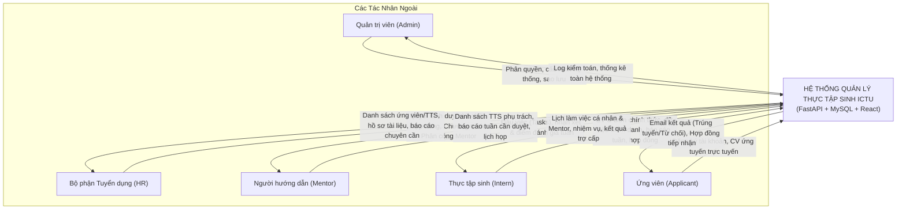
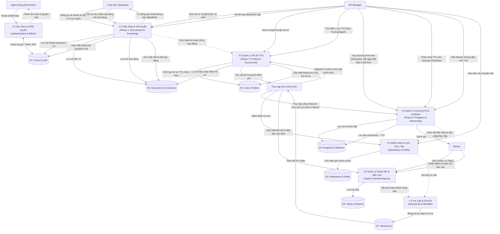
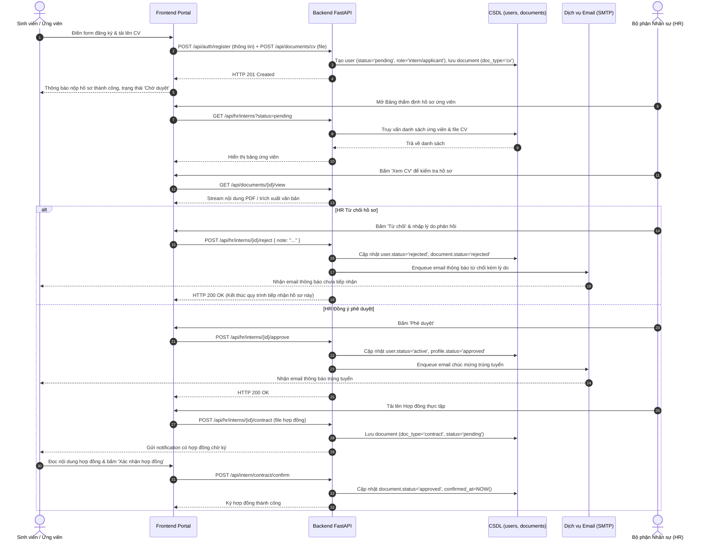
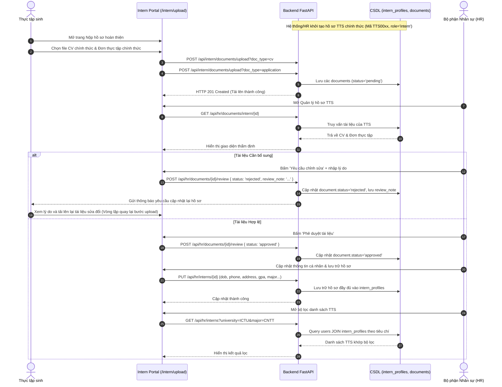
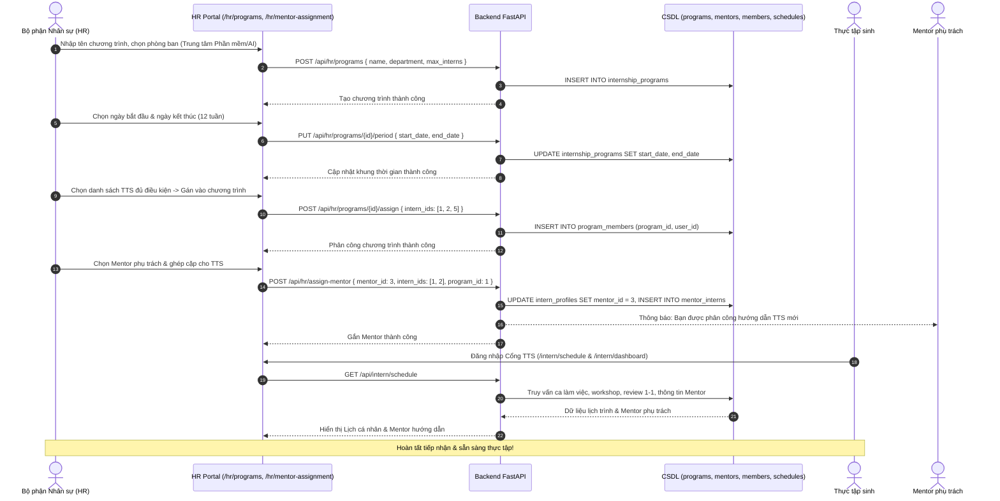

# SƠ ĐỒ LUỒNG DỮ LIỆU HỆ THỐNG (SYSTEM DATA FLOW DIAGRAM - DFD)
## Dự án: Hệ Thống Quản Lý Thực Tập Sinh ICTU (Product Backlog Internship)

---

## 1. TỔNG QUAN HỆ THỐNG & CÁC TÁC NHÂN (ACTORS)

Hệ thống quản lý thực tập sinh ICTU bao gồm 5 vai trò (Role-Based Access Control - RBAC):
1. **Admin (Quản trị viên)**: Quản lý người dùng, phân quyền, cấu hình hệ thống, sao lưu cơ sở dữ liệu và danh mục phòng ban.
2. **HR (Bộ phận Tuyển dụng & Nhân sự)**: Tiếp nhận hồ sơ, thẩm định, duyệt/từ chối ứng viên, khởi tạo hồ sơ TTS chính thức, tạo chương trình theo phòng ban, thiết lập lịch, phân công TTS & gán Mentor, tính phụ cấp/chế độ.
3. **Mentor (Người hướng dẫn)**: Nhận TTS phân công, giao nhiệm vụ (tasks), kiểm tra tiến độ, đánh giá báo cáo tuần và chấm điểm năng lực cuối kỳ.
4. **Intern (Thực tập sinh chính thức)**: Hoàn thiện hồ sơ (CV & đơn thực tập), xem lịch cá nhân & Mentor, điểm danh, nhận việc, nộp báo cáo tuần, xem phụ cấp.
5. **Applicant (Ứng viên ứng tuyển)**: Đăng ký tài khoản, nộp hồ sơ/CV trực tuyến ban đầu, theo dõi trạng thái phê duyệt, ký xác nhận hợp đồng khi được chấp nhận.

---

## 2. SƠ ĐỒ NGỮ CẢNH (DFD LEVEL 0 - CONTEXT DIAGRAM)

Sơ đồ mô tả luồng trao đổi dữ liệu tổng thể giữa Hệ thống Portal Thực tập sinh ICTU và các tác nhân bên ngoài.

---

## 3. SƠ ĐỒ PHÂN RÃ CHỨC NĂNG (DFD LEVEL 1)

---

## 4. CHI TIẾT CÁC LUỒNG DỮ LIỆU CỐT LÕI (DFD LEVEL 2)

### 4.1. SƠ ĐỒ TỔNG THỂ VÒNG ĐỜI TIẾP NHẬN & QUẢN LÝ (3 GIAI ĐOẠN CHUẨN)

Sơ đồ thể hiện trực quan quy trình nghiệp vụ từ lúc sinh viên đăng ký cho đến khi sẵn sàng thực tập.

```mermaid
flowchart TD
    Start(["Bắt đầu: Sinh viên đăng ký"]):::startEndClass --> Step1

    %% ----------------------------------------------------
    %% GIAI ĐOẠN 1
    %% ----------------------------------------------------
    subgraph G1 ["Giai đoạn 1: Tiếp nhận & Xét duyệt"]
        Step1["TTS đăng ký tài khoản & nộp hồ sơ trực tuyến"]:::boxProcess
        Step2["HR xem & kiểm tra hồ sơ ứng viên"]:::boxProcess
        CheckHR{"HR duyệt hồ sơ?"}:::diamondCheck

        RejectMail["Hệ thống gửi email thông báo từ chối"]:::boxReject
        EndProcess(["Kết thúc quy trình"]):::startEndClass

        ApproveMail["Hệ thống gửi email thông báo trúng tuyển"]:::boxApprove
        UploadContract["HR tải lên hợp đồng thực tập"]:::boxProcess
        ConfirmContract["TTS xem & xác nhận hợp đồng trên hệ thống"]:::boxProcess

        Step1 --> Step2
        Step2 --> CheckHR
        CheckHR -->|Từ chối| RejectMail
        RejectMail --> EndProcess
        CheckHR -->|Đồng ý| ApproveMail
        ApproveMail --> UploadContract
        UploadContract --> ConfirmContract
    end

    %% ----------------------------------------------------
    %% GIAI ĐOẠN 2
    %% ----------------------------------------------------
    subgraph G2 ["Giai đoạn 2: Quản lý hồ sơ thực tập sinh"]
        InitProfile["Hệ thống/HR khởi tạo hồ sơ thực tập sinh chính thức"]:::boxProcess
        UploadOfficialDocs["TTS upload CV & đơn thực tập chính thức để hoàn thiện hồ sơ"]:::boxProcess
        HRReviewDocs["HR xem & duyệt tài liệu hồ sơ của TTS"]:::boxProcess
        CheckDocs{"Tài liệu hợp lệ?"}:::diamondCheck

        RequestSupplement["HR yêu cầu TTS cập nhật/chỉnh sửa hồ sơ"]:::boxProcess
        SaveProfile["HR cập nhật thông tin cá nhân & lưu trữ hồ sơ đầy đủ"]:::boxApprove
        FilterInterns["HR có thể tìm kiếm/lọc TTS theo Trường/Ngành"]:::boxProcess

        InitProfile --> UploadOfficialDocs
        UploadOfficialDocs --> HRReviewDocs
        HRReviewDocs --> CheckDocs
        CheckDocs -->|Cần bổ sung| RequestSupplement
        RequestSupplement -->|"Sửa đổi tài liệu"| UploadOfficialDocs
        CheckDocs -->|Hợp lệ| SaveProfile
        SaveProfile --> FilterInterns
    end

    %% ----------------------------------------------------
    %% GIAI ĐOẠN 3
    %% ----------------------------------------------------
    subgraph G3 ["Giai đoạn 3: Quản lý chương trình thực tập"]
        CreateProgram["HR tạo chương trình thực tập theo phòng ban"]:::boxProcess
        SetSchedule["HR thiết lập lịch thực tập: Ngày bắt đầu & Kết thúc"]:::boxProcess
        AssignInterns["HR phân công thực tập sinh vào chương trình/nhóm"]:::boxProcess
        AssignMentor["HR gắn Mentor hướng dẫn cho TTS"]:::boxProcess
        ViewPortal["TTS truy cập cổng thông tin xem Lịch thực tập cá nhân & Mentor"]:::boxProcess

        CreateProgram --> SetSchedule
        SetSchedule --> AssignInterns
        AssignInterns --> AssignMentor
        AssignMentor --> ViewPortal
    end

    %% Chuyển giao các giai đoạn
    ConfirmContract --> InitProfile
    FilterInterns --> CreateProgram
    ViewPortal --> Ready(["Hoàn tất tiếp nhận & sẵn sàng thực tập"]):::startEndClass

    %% Class Styling
    classDef startEndClass fill:#f472b6,stroke:#db2777,stroke-width:2px,color:#ffffff,font-weight:bold;
    classDef boxProcess fill:#bae6fd,stroke:#0284c7,stroke-width:1.5px,color:#0f172a;
    classDef diamondCheck fill:#fef08a,stroke:#ca8a04,stroke-width:2px,color:#713f12,font-weight:bold;
    classDef boxApprove fill:#bbf7d0,stroke:#16a34a,stroke-width:1.5px,color:#14532d;
    classDef boxReject fill:#fecdd3,stroke:#e11d48,stroke-width:1.5px,color:#881337;
```

---

### 4.2. CHI TIẾT TRÌNH TỰ TƯƠNG TÁC (SEQUENCE DIAGRAMS)

#### 4.2.1. Giai đoạn 1: Tiếp nhận & Xét duyệt (Sequence Diagram)

---

#### 4.2.2. Giai đoạn 2: Quản lý hồ sơ thực tập sinh (Sequence Diagram)

---

#### 4.2.3. Giai đoạn 3: Quản lý chương trình thực tập (Sequence Diagram)

---

## 5. MA TRẬN ÁNH XẠ DỮ LIỆU & BẢO VỆ ENDPOINTS (API DATA MATRIX)

| Thực thể dữ liệu | Tác nhân chính | Phương thức & Endpoint | Quyền hạn (RBAC) | Mô tả xử lý dữ liệu |
|---|---|---|---|---|
| **Users / Auth** | Public / Mọi roles | `POST /api/auth/register` `POST /api/auth/login` | Public | Đăng ký tài khoản ứng viên, xác thực bcrypt và cấp JWT |
| **Candidate CV** | Applicant | `POST /api/documents/cv` | Public / Applicant | Upload file CV ứng tuyển ban đầu vào hệ thống |
| **Candidate Approval**| HR, Admin | `POST /api/hr/interns/{id}/approve` | HR, Admin | Duyệt hồ sơ trúng tuyển, tự động kích hoạt gửi email trúng tuyển |
| **Candidate Reject**  | HR, Admin | `POST /api/hr/interns/{id}/reject`  | HR, Admin | Từ chối hồ sơ, tự động gửi email giải thích lý do |
| **Contract Upload**   | HR, Admin | `POST /api/hr/interns/{id}/contract`| HR, Admin | HR tải lên hợp đồng tiếp nhận thực tập |
| **Contract Confirm**  | Intern / Applicant | `POST /api/intern/contract/confirm` | Intern | TTS ký/xác nhận hợp đồng trên hệ sinh thái |
| **Official Docs**     | Intern | `POST /api/intern/documents/upload` | Intern | TTS nộp CV & Đơn thực tập chính thức để hoàn thiện hồ sơ |
| **Document Review**   | HR, Admin | `POST /api/hr/documents/{id}/review`| HR, Admin | HR thẩm định: Duyệt hợp lệ hoặc yêu cầu TTS bổ sung sửa đổi |
| **Update Profile**    | HR, Admin | `PUT /api/hr/interns/{id}`          | HR, Admin | HR cập nhật thông tin cá nhân và lưu trữ hồ sơ đầy đủ |
| **Filter by Uni/Major**| HR, Admin | `GET /api/hr/interns?university=&major=` | HR, Admin, Mentor | Tìm kiếm và lọc TTS theo Trường đại học và Ngành đào tạo |
| **Program Setup**     | HR, Admin | `POST /api/hr/programs`             | HR, Admin | HR tạo chương trình thực tập theo phòng ban |
| **Program Period**    | HR, Admin | `PUT /api/hr/programs/{id}/period`  | HR, Admin | HR cấu hình ngày bắt đầu & ngày kết thúc chương trình |
| **Program Assign**    | HR, Admin | `POST /api/hr/programs/{id}/assign` | HR, Admin | Phân công TTS vào kỳ thực tập và nhóm chuyên môn |
| **Mentor Assign**     | HR, Admin | `POST /api/hr/assign-mentor`        | HR, Admin | Gắn Mentor hướng dẫn 1-1 hoặc theo nhóm cho TTS |
| **Personal Schedule** | Intern | `GET /api/intern/schedule`          | Intern | TTS xem Lịch thực tập cá nhân & thông tin Mentor phụ trách |
| **Attendance Check**  | Intern | `POST /api/intern/attendance/check-in`| Intern | TTS chấm công ca làm việc qua mã QR / GPS |
| **Task Management**   | Mentor / Intern | `POST /api/mentor/tasks` `PATCH /api/intern/tasks/{id}` | Mentor, Intern | Mentor giao task, TTS cập nhật tiến độ công việc |
| **Weekly Reports**    | Intern / Mentor | `POST /api/intern/weekly-reports` `POST /api/mentor/reports/{id}/review` | Intern, Mentor | TTS nộp báo cáo tuần, Mentor chấm điểm & phản hồi |
| **Allowances**        | HR, Admin | `GET /api/hr/allowances`            | HR, Admin | Tính toán và phê duyệt phụ cấp thực tập sinh |

---

## 6. NGUYÊN TẮC BẢO MẬT & ĐẢM BẢO TOÀN VẸN DỮ LIỆU

1. **Phân quyền đa lớp (Dual-Layer RBAC)**:
   - **Frontend Router Guard**: Bắt buộc kiểm tra quyền truy cập theo vai trò trước khi nạp trang. Chuyển hướng chính xác về portal tương ứng (`/hr`, `/intern`, `/mentor`, `/admin`).
   - **FastAPI Backend Depends**: Mọi endpoint đều bảo vệ bởi `require_roles(...)`. Token được giải mã và kiểm tra quyền hạn chặt chẽ trên mỗi request.
2. **Xử lý toàn vẹn dữ liệu trong vòng lặp hồ sơ**:
   - Khi hồ sơ cần bổ sung, trạng thái tài liệu chuyển sang `rejected` kèm ghi chú hướng dẫn, không làm mất lịch sử các lần nộp trước đó.
   - Khi ứng viên nộp lại tài liệu sửa đổi, trạng thái được tự động reset về `pending` và bắn thông báo tới HR để thẩm định lại.
3. **Đồng bộ hóa thời gian thực (Real-time Cross-Portal Synchronization)**:
   - Khi HR duyệt hồ sơ, tải hợp đồng hoặc phân công Mentor, các sự kiện thời gian thực tự động kích hoạt cập nhật giao diện Cổng TTS mà không cần tải lại trang.
